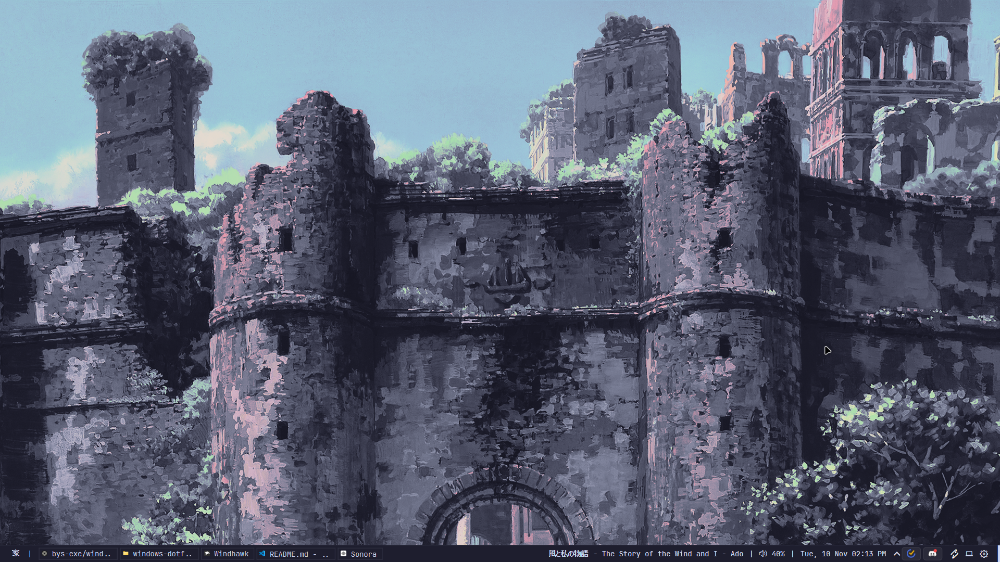
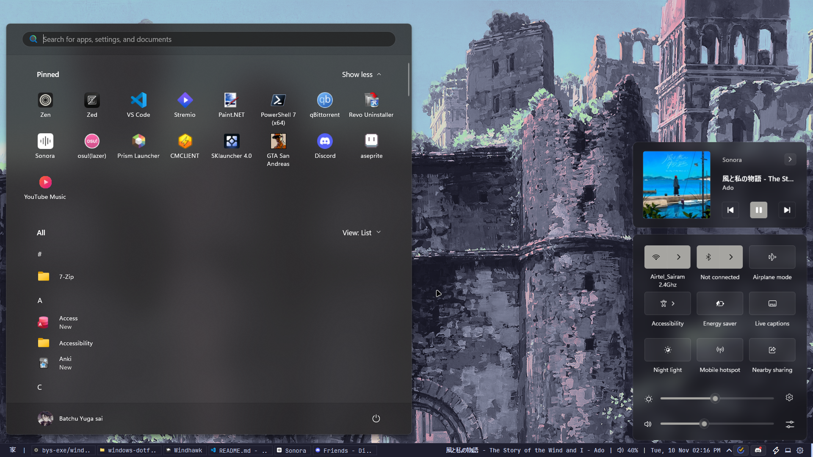
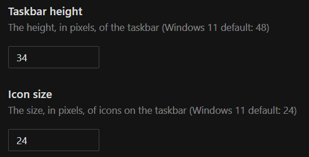
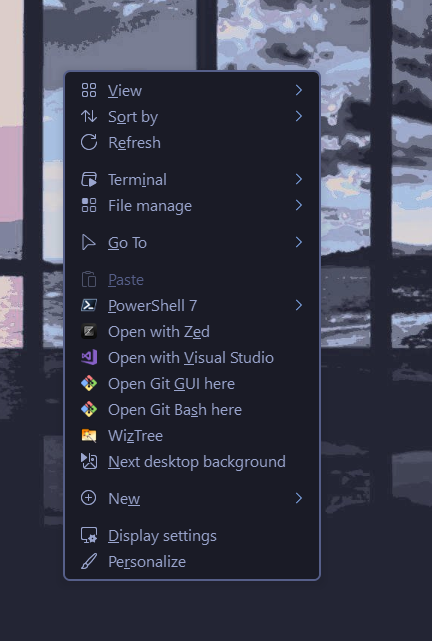

# windows-dotfiles

do you want your windows to look like mine?
here are some screenshots

this is the setup i use on windows to larp linux :smirk :

## yasb

yet another status bar aka yasb is my replacement for
windows taskbar cuz it is genuinely ass and big for no reason.
you can use yasb along with taskbar if u wanna larp like macos but yeah, the required files are in ./yasb

## taskbar hide

to get rid of taskbar completely i used an app called [Taskbar hide](https://github.com/amnweb/thide) which starts at boot and disables the taskbar.

## windhawk

i use windhawk to modify the look of windows and disable some things and few other qol changes.
the mods i use are-

- Taskbar height and icon size (config below)
  
- Windows 11 notification center (notification-center.yaml is the config for you to paste, and add TextInputHost.exe to custom process inclusion list if u wanna see the same look in clipboard history and all that)
- Taskbar on top for windows 11 (when i wanna access for some very random reason)

## flow launcher

this is like spotlight in macos but on steroids xD u can search for any file and app with the alt+space shortcut and if u add the 'everything' plugin to it u will get any file u want in an instant which is sooo much faster than windows search.

## shareX

this is a screenshot utility app which has more functions to it than normal windows screenshot which is nice

## nilesoft shell

if you want the context menu (the menu when u right click) to look different, the program called nilesoft shell lets us customize that

## wallpapers

if you want wallpapers [this](https://github.com/SleepyCatHey/CozyPixels) is a very good repository with tons of catppuccin wallpapers :D

## credits

**BIG thanks to [MrDLingsters](https://github.com/MrDLingters)** because if it werent for u i would never find windows true potential aesthetic wise, if anyone wants more themes check his github out!
